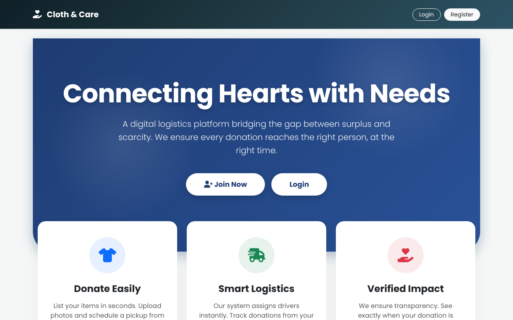
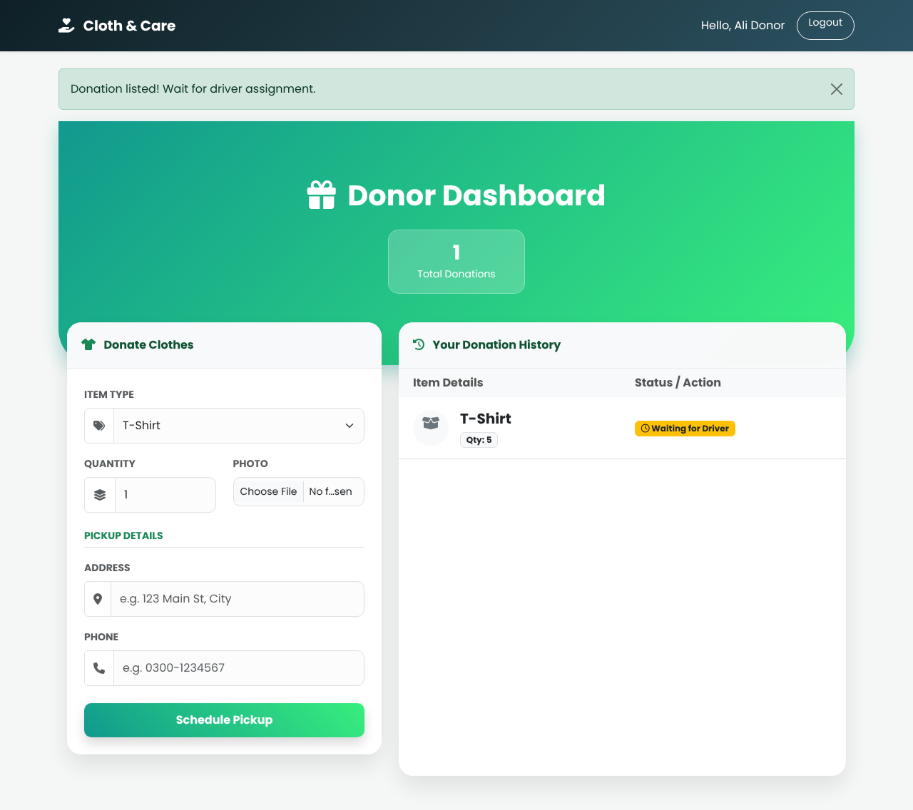
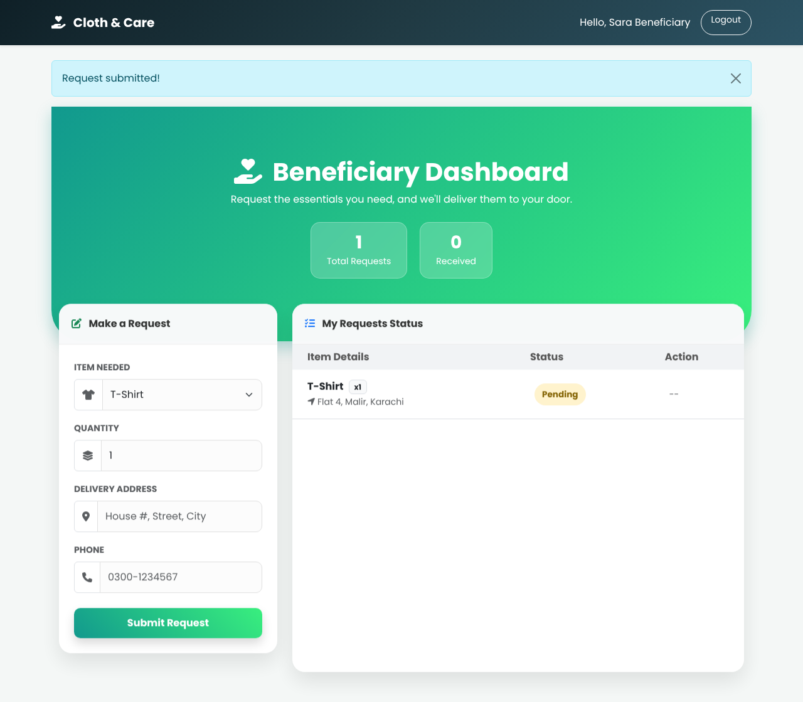
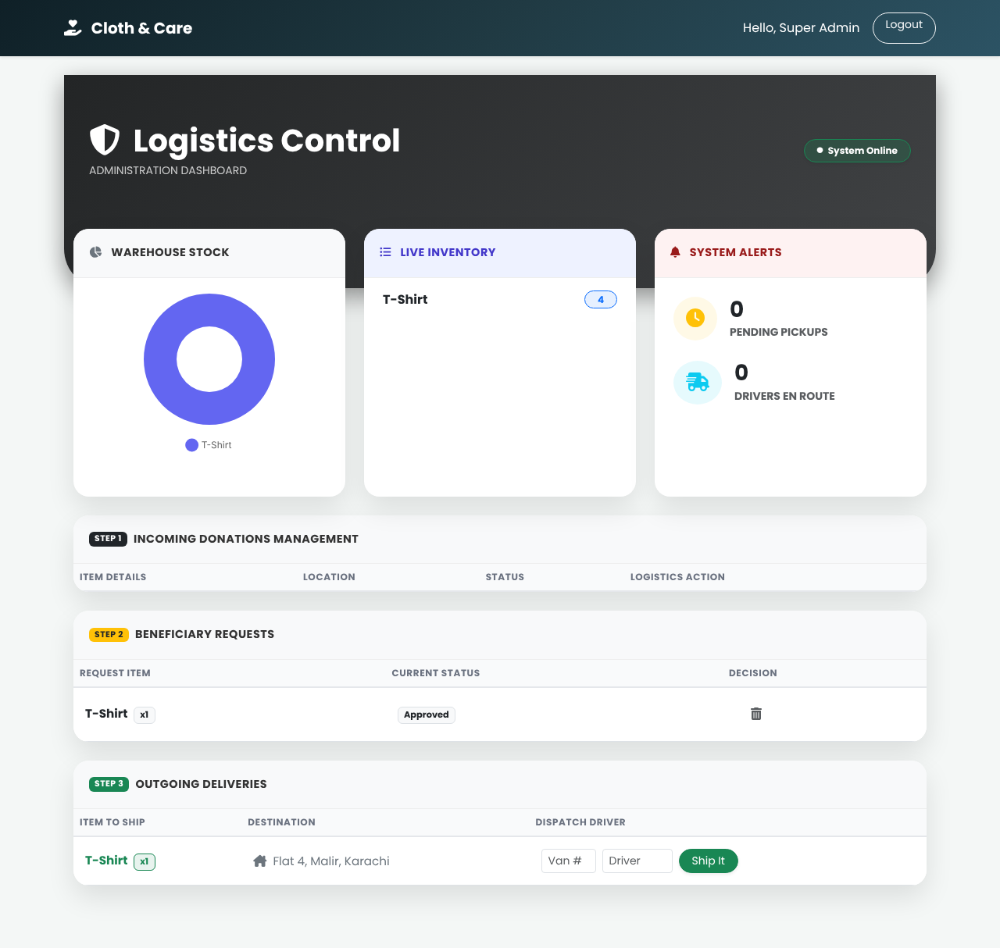

# Cloth & Care: Smart Apparel Inventory & Distribution System 👕🚚

A web platform that connects people who want to **donate clothes** with people who **need them**, and gives an admin a simple logistics dashboard to manage pickups, warehouse stock and deliveries.



## How it works

1. A **donor** lists items (T-Shirt, Jeans, Blanket, Jackets, Shoes) with quantity, photo, pickup address and phone.
2. The **admin** assigns a driver and vehicle to pick up the donation.
3. When the items arrive, the admin confirms arrival and the **warehouse inventory** goes up.
4. A **beneficiary** requests the items they need, with delivery address and phone.
5. The admin approves the request (stock goes down) and assigns a driver for delivery.
6. The beneficiary confirms they received the items.

## Features

- Three roles: **Donor**, **Beneficiary** and **Admin**, each with its own dashboard
- Registration and login with session handling
- Donation form with photo upload, pickup address and phone number
- Request form for beneficiaries (maximum 5 items per request)
- Admin dashboard with a stock chart, live inventory, and system alerts
- Three-step admin workflow: incoming donations, beneficiary requests, outgoing deliveries
- Driver and vehicle assignment for both pickups and deliveries
- Automatic inventory update when a donation arrives or a request is approved
- Approve, reject and delete actions for requests
- Responsive pages built with Bootstrap

## Screenshots

| Donor | Beneficiary |
|-------|-------------|
|  |  |



The screenshots use sample test data.

## Tech stack

| Layer | Technology |
|-------|------------|
| Backend | Python, Flask |
| Database | SQLite with Flask-SQLAlchemy |
| Frontend | HTML, Jinja2 templates, Bootstrap 5, Font Awesome, Chart.js |

Bootstrap, Font Awesome, Chart.js and Google Fonts load from a CDN, so an internet connection is needed to see the full styling.

## Project structure

```
smart-apparel-distribution-system/
├── app.py                  # Flask app: routes for login, donor, beneficiary and admin
├── models.py               # Database models: User, Donation, Request, Inventory, Delivery
├── requirements.txt        # Python dependencies
├── templates/
│   ├── base.html           # Shared layout
│   ├── index.html          # Landing page
│   ├── login.html
│   ├── register.html
│   ├── donor_dashboard.html
│   ├── beneficiary_dashboard.html
│   └── admin_dashboard.html
├── static/uploads/         # Donation photos are saved here
├── docs/screenshots/       # Images used in this README
├── .gitignore
├── LICENSE
└── README.md
```

## Getting started

### Requirements
- [Python 3.10 or newer](https://www.python.org/downloads/)

### 1. Clone the repository
```bash
git clone https://github.com/abdulrafey05/smart-apparel-distribution-system.git
cd smart-apparel-distribution-system
```

### 2. Create a virtual environment and install the packages
```bash
python -m venv venv
venv\Scripts\activate        # Windows
# source venv/bin/activate   # macOS / Linux
pip install -r requirements.txt
```

### 3. Run the app
```bash
python app.py
```
Open `http://127.0.0.1:5000` in your browser. The database file is created automatically the first time you run the app.

On Windows the app also tries to open itself in an Edge app window. On other systems, just open the address above in your browser.

## Demo admin account

The app creates one admin account on first run:

| Email | Password |
|-------|----------|
| admin@gmail.com | admin |

Donor and beneficiary accounts are created from the **Register** page.

## Database models

| Model | Purpose |
|-------|---------|
| User | Name, email, password and role (donor, beneficiary or admin) |
| Donation | Item, quantity, photo, pickup address, phone and status |
| Request | Item, quantity, delivery address, phone and status |
| Inventory | Current warehouse stock for each item type |
| Delivery | Driver, vehicle and status for a pickup or a drop-off |

## Status flow

- **Donation:** Pending Pickup, Driver Assigned, In Stock
- **Request:** Pending, Approved or Rejected, Received by User
- **Delivery:** Assigned, Completed

## Limitations and future work

This is a student project made to learn Flask. Before using it for real:

- Passwords are stored as plain text. Hash them (for example with Werkzeug `generate_password_hash`).
- The secret key and the demo admin account are written in `app.py`. Move them to environment variables.
- Admin action links are not checked for the admin role. Add a role check on every admin route.
- Add input checks for uploads (file type and size) and for form values.
- Add email or SMS notifications and a map for pickup addresses.

## Author

**Muhammad Abdul Rafey Yashir**
BS Artificial Intelligence student, Karachi, Pakistan
- LinkedIn: [abdulrafeyyashir](https://www.linkedin.com/in/abdulrafeyyashir)
- Email: arafeyyashir@gmail.com
- Portfolio: [abdulrafey05.github.io/Portfolio](https://abdulrafey05.github.io/Portfolio/)

## License

This project is licensed under the MIT License. See the [LICENSE](LICENSE) file.
